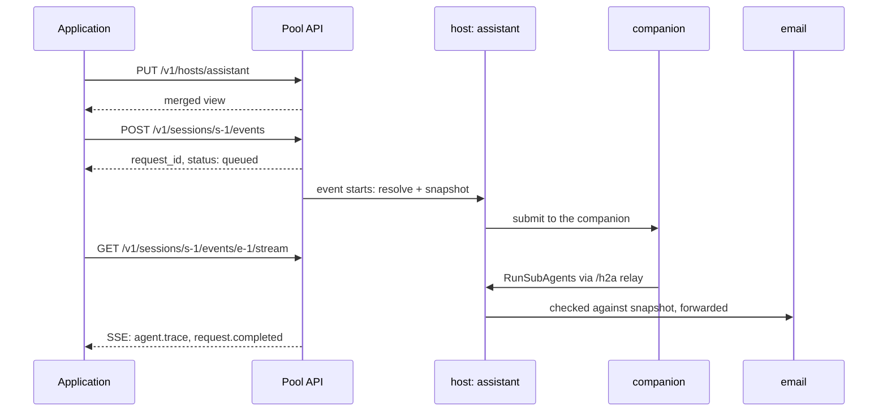

# Building Dynamic Hosts over the API

A Mash deployment is a pool of agents; which agents work together on a
request is decided by a host, and hosts are plain data. This guide covers
the API-only version of that flow: an application that inspects the pool,
composes a host over HTTP, posts events to it, and streams the
results. No Mash CLI involved, and the application can be written in any
language, since the whole surface is HTTP + SSE.

The running example is a personal assistant backend. The pool ships two
agents, `email` and `calendar`, plus the built-in `companion` every pool has.
The application decides per task which agents go into a host, and the
companion routes each message among them.

## The pool

The server side is the only Python in this guide, and it's deployed once:

```python
# assistant/spec.py
from mash.runtime import AgentMetadata, HostBuilder

def build_pool():
    return (
        HostBuilder()
        .agent(EmailAgent(),     metadata=AgentMetadata(...))
        .agent(CalendarAgent(),  metadata=AgentMetadata(...))
        .build()
    )
```

```bash
mash host serve --host-app assistant.spec:build_pool --port 8000
```

No `.host(...)` call. The pool starts with three live runtimes, the two
agents and the companion, and zero compositions. The companion picks its
model from the provider keys on the host (`GEMINI_API_KEY`,
`OPENAI_API_KEY`, `ANTHROPIC_API_KEY` or `OSS_BASE_URL`). (For the full
`AgentSpec` walkthrough, see [Building an Agent CLI](building-agent-clis.md).)

All requests below go to `http://127.0.0.1:8000/api/v1`. If the deployment
sets `MASH_API_KEY`, add `Authorization: Bearer <key>` to each one.

## Inspect the pool

```bash
curl http://127.0.0.1:8000/api/v1/agent
```

```json
{
  "data": {
    "agents": [
      {"agent_id": "email",     "metadata": {"display_name": "Email", ...}},
      {"agent_id": "calendar",  "metadata": {"display_name": "Calendar", ...}},
      {"agent_id": "companion", "metadata": {"display_name": "Companion", ...}}
    ],
    "hosts": []
  }
}
```

The `metadata` on each agent is its self-description from registration:
display name, description, capabilities, and usage guidance. In a host, this
metadata becomes the agent directory the companion's model reads to decide
which agents a message belongs to, so it's also what an application should
show a user who is assembling a team.

## Define a host

A host names a set of agents and, optionally, workflows, all by id. It never
lists the companion, which routes for every host:

```bash
curl -X PUT http://127.0.0.1:8000/api/v1/hosts/assistant \
  -H "Content-Type: application/json" \
  -d '{"agents": ["email", "calendar"]}'
```

The response is the merged view, members joined with their pool metadata:

```json
{
  "data": {
    "host_id": "assistant",
    "agents": [
      {"agent_id": "email",    "metadata": {...}},
      {"agent_id": "calendar", "metadata": {...}}
    ],
    "workflows": []
  }
}
```

Validation happens here, synchronously. An agent id that isn't a pooled
agent, the companion itself, or a workflow id that isn't registered returns
`400 INVALID_HOST` with the offending id in the message. A body with fields
other than `agents` and `workflows` fails with `422`.

`PUT` is define-or-replace, so re-sending the same body is a no-op and
sending a different body swaps the composition for future requests. There
is no `DELETE`; a host you stop using costs nothing.

`GET /v1/hosts` lists the definitions, `GET /v1/hosts/{host_id}` returns
the merged view for one (`404 HOST_NOT_FOUND` for unknown ids).

## Create a policy

Every event runs under a policy, which owns the sandbox and the browser
profile and sets the rules for requests under it. Create one once:

```bash
curl -X PUT http://127.0.0.1:8000/api/v1/policies/acme \
  -H "Content-Type: application/json" \
  -d '{"sandbox": true, "wait_max_seconds": 86400}'
```

## Post an event to it

Every message to a host is an event in a session:

```bash
curl -X POST http://127.0.0.1:8000/api/v1/sessions/s-1/events \
  -H "Content-Type: application/json" \
  -d '{"event_id": "e-1", "host_id": "assistant", "app_id": "assistant-app",
       "policy_id": "acme", "message": "triage my inbox and block focus time"}'
```

```json
{
  "data": {
    "session_id": "s-1",
    "event_id": "e-1",
    "request_id": "5f0c2b1e-...",
    "seq": 1,
    "status": "queued",
    ...
  }
}
```

The first event binds session `s-1` to the `assistant` host and the `acme`
policy. Events in a session run one at a time, in arrival order; each runs as
one request on the companion. When the event starts, the server resolves the
host and snapshots `{host_id, agents, workflows}` onto the request. For every
turn of that request, the companion's system prompt carries a directory of
exactly those agents, and its `RunSubAgents` tool accepts only those ids.

`session_id` and `event_id` are yours to choose. Conversation history lives
with the companion, keyed by agent and session, so a later event in the same
session continues the conversation. Each agent the companion runs works in a
session of its own, and a follow-up goes back to the session that answered.
Posting an `event_id` the session already has returns the existing row, so a
retried POST runs once. The body also accepts `context`, `metadata` and a
`structured_output` JSON schema.

## Stream the lifecycle

```bash
curl -N http://127.0.0.1:8000/api/v1/sessions/s-1/events/e-1/stream
```

While the event waits behind earlier ones, the stream holds with an
`event.queued` frame. Then it relays the companion request's frames, the same
SSE stream every Mash request has:

| Event | Meaning |
|---|---|
| `request.started` | the request's loop began executing |
| `agent.trace` | a step happened: a think, a tool call, a `RunSubAgents` call |
| `request.interaction.create` | the agent paused for human input (see below) |
| `request.interaction.ack` | the input was received |
| `request.completed` | terminal; `data.response.text` holds the answer |
| `request.error` | terminal; `data.error` holds the failure |

While the companion routes, each child request runs on its agent with its own
stream. The companion's `agent.trace` frame for the `RunSubAgents` call
(`event_type: execute_tool.start`) lists each child's `agent_id` and
`request_id` under `payload.subagents`; open
`GET /v1/agent/{agent_id}/request/{request_id}/events` for each one to show
the whole team working.

An event can carry a W3C `traceparent` header (and `tracestate`). The request
then exports inside the caller's trace when the host sends traces over OTLP;
see the [trace post](reading-a-trace.md).

If the companion, or an agent it runs, asks the user something, the stream
emits `request.interaction.create` with an `interaction_id` and the request
parks durably until the application answers on the same endpoint, naming the
event:

```bash
curl -X POST http://127.0.0.1:8000/api/v1/sessions/s-1/events \
  -H "Content-Type: application/json" \
  -d '{"event_id": "e-1", "interaction_id": "itr_ab12cd34ef56", "response": "tomorrow morning"}'
```



## What the snapshot means for your application

Three properties fall out of the snapshot, and they shape how an
application should use hosts:

**Redefinition is safe.** Re-`PUT`ting a host while requests are in flight
changes nothing for them; each request replays from the composition it
started with, including across a crash and recovery. Only events that start
later see the new definition.

**Compositions are cheap.** A host is a few strings on the server. An
application can define a host per task ("compose `email` + `calendar`
for this command"), use it for a handful of events,
and never clean it up.

**Hosts are in-memory.** A deployment restart keeps the pool (it's code)
and drops API-defined hosts. A new event naming a host that is not defined
gets `404 HOST_NOT_FOUND`, and an event already queued for it waits until a
`PUT` defines it again. The pattern is to re-`PUT` your hosts
on application startup, which is free because the call is idempotent. If the
deployment runs multiple replicas behind a load balancer, a `PUT` lands on
one replica, so startup re-definition should hit each replica or the hosts
should move into `build_pool()`. The
[deploy guide](how-to-deploy.md) covers this in the scaling section.

## Observe by composition

Every runtime event written during an event's request carries the
`host_id` from its snapshot, and the telemetry API filters on it:

```bash
curl "http://127.0.0.1:8000/api/v1/telemetry/events?agent_id=companion&host_id=assistant&limit=100"
```

A workflow's agent steps carry `host_id: null`, so the same query
distinguishes the companion's work for the `assistant` composition from its
work for any other host.

## The same flow from Python

For Python applications, `MashHostClient` wraps every call above:

```python
import asyncio

from mash.cli import MashHostClient

client = MashHostClient("http://127.0.0.1:8000", api_key="...")

client.list_agents()
client.define_host("assistant", agents=["email", "calendar"])
client.put_policy("acme", {"sandbox": True})
client.post_event("s-1", event_id="e-2", host_id="assistant",
                  app_id="assistant-app", policy_id="acme",
                  message="triage my inbox")

async def answer() -> None:
    async for event in client.event_events("s-1", "e-2"):
        if event["event"] == "request.completed":
            print(event["data"]["response"]["text"])

asyncio.run(answer())
client.close()
```

The full route reference lives in the
[API README](https://github.com/imsid/mashpy/blob/main/src/mash/api/README.md),
and [The Host API and CLI](host-api-and-cli.md) covers the rest of the HTTP
surface this builds on.
