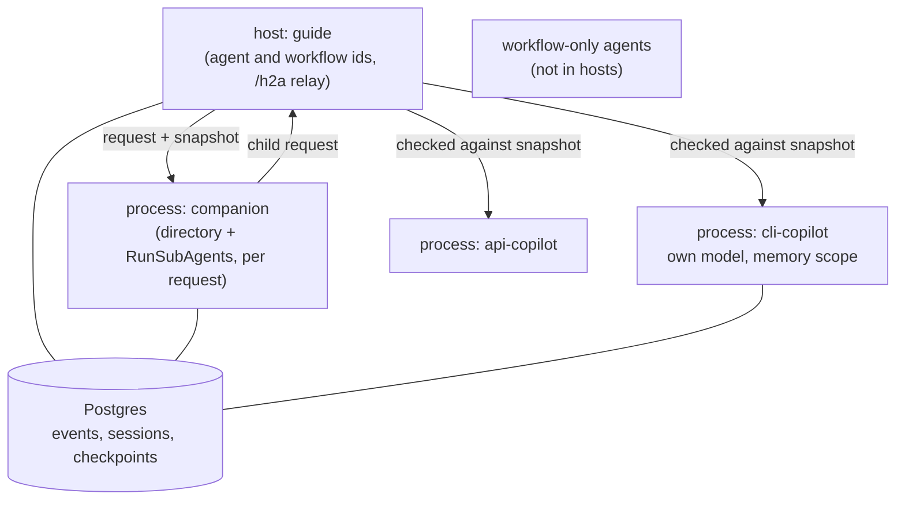

# Composing Agents Under One Host

A Mash deployment is a flat pool of agents plus the hosts composed over them:

```python
pool = (
    HostBuilder()
    .agent(PilotSpec(), metadata=AgentMetadata(...))
    .agent(
        CliCopilot(),
        metadata=AgentMetadata(
            display_name="CLI Copilot",
            description="Answers questions about the mash CLI.",
            capabilities=["cli commands", "repl usage"],
            usage_guidance="Use for CLI-specific questions.",
        ),
    )
    .agent(ApiCopilot(), metadata=AgentMetadata(...))
    .host(Host(host_id="guide", agents=("pilot", "cli-copilot", "api-copilot")))
    .build()
)
```

Each spec becomes a full `AgentRuntime` with its own model, tools, config, and memory scope, everything this series has covered. When the host starts, each one runs in its own process, a subprocess of the host. The builder also registers one agent the app never writes: `companion`, the built-in router. The pool is the unit of deploy, and a `Host` is the unit of composition.

## Hosts are data

A `Host` names a set of agents and, optionally, workflows, all by id. Every member is the same kind of member. A `Host` is an immutable value, defined in code at build time like above, or on a running pool over the control API:

```bash
curl -X PUT http://127.0.0.1:8000/api/v1/hosts/cli-help \
  -d '{"agents": ["cli-copilot"], "workflows": []}'
```

Submitting to a host (`POST /v1/hosts/{host_id}/request`) runs the request on the companion and snapshots `{host_id, agents, workflows}` onto it. The snapshot rides inside the request's checkpointed state, so a crashed request recovers with the composition it started with, even if someone re-`PUT` the host mid-flight. Redefining a host only affects new requests.

An agent can be in any number of hosts at once. Hosts are a few strings, so they're cheap to create: a client application can compose a host per task, route a few requests through it, and forget it.

## Metadata and the agent directory

`AgentMetadata` is required at registration; `register_agent` rejects an agent without it. The companion routes by it. When a request carries a host snapshot, the per-turn agent build appends an `AGENTS` directory to the companion's system prompt: each of the host's agents with its display name, description, capabilities and usage guidance. The companion's model reads that directory to decide which agents a message belongs to.

Routing quality is therefore a prompt-engineering surface. Vague `usage_guidance` produces vague routing.

The directory is per request. A request sent to one agent directly (`POST /v1/agent/{agent_id}/request`) bypasses the companion, and that agent gets neither the directory nor a routing tool.

## RunSubAgents

Alongside the directory, the per-turn build installs one tool on the companion, and on no other agent:

```python
# src/mash/tools/subagent.py
class RunSubAgentsTool:
    name = "RunSubAgents"
    parameters = {
        "type": "object",
        "properties": {
            "requests": {
                "type": "array",
                "items": {
                    "type": "object",
                    "properties": {
                        "agent_id": {"type": "string", ...},
                        "prompt": {"type": "string"},
                        "session_id": {"type": "string", ...},
                        "output_schema": {"type": "object", ...},
                    },
                    "required": ["agent_id", "prompt"],
                },
            },
            "timeout_seconds": {"type": "integer", ...},  # defaults to AgentConfig.subagent_timeout_seconds (3600), at most that
        },
        "required": ["requests"],
    }
```

Each item runs as its own child request on one of the host's agents, and all of them run at the same time. One item hands a message to one agent. Several items split a request whose parts don't depend on each other, to different agents or to the same agent more than once. The tool returns when every child has ended, with one entry per item in order: the child's request id, the session it ran in, its trace id, its status, and its response or error. A child gets no `AskUser`, since the user talks to the companion.

Each agent runs in its own process, so starting a child is an HTTP call. The companion's process submits a normal Mash request, in `bg` mode, to the host's `/h2a` relay with its agent token, a `parent` naming the calling request, and the request's host snapshot. The relay refuses an agent id that isn't in the `agents` of the snapshot stored with the parent request, even if it exists in the pool, and forwards the rest to that agent's process. The child request goes down the same `submit_request` path and durable loop as any external request, and its response streams back through the relay to become the tool result the companion observes on its next think.

Each child runs in a session of its own. Without a `session_id` in its item, the child starts a new session named after its request id, so a replayed call lands in the same one. With the `session_id` of an earlier entry, it continues that session and replays its own earlier briefs and answers. Two runs of one agent in two sessions never see each other's work, and the companion's conversation never replays a child's turns, since memory is keyed by session and `app_id`. The relay lets a child continue only a session of the same agent that was started from the companion's session.

The companion keeps track of which session produced which answer in a ledger. When its turn is saved, every `RunSubAgents` entry of the request becomes a line in the turn's metadata: the agent, its session, its trace, the status, the brief and the answer, both clipped. Replay appends the ledger to the companion's reply, for the model only, so a follow-up such as "why did you use feedparser?" goes back to the session the ledger lists under that reply.

The child's events stay in its own log, under its own request id. The companion's `execute_tool.start` for `RunSubAgents` names each child's agent and request id, so a client streaming the companion's request can open each child's stream and watch the routing happen live, which is what the REPL does. The [trace projection](reading-a-trace.md) uses the same ids to nest each child's `invoke_agent` span under the call that started it, so the admin UI, trace analysis and an OTLP export all show the request as one trace.



`RunSubAgents` runs as an ordinary step. Each child request is submitted under an id derived from the companion's request id, the call's position and the item's index: a UUID5 of `{request_id}-sub-{loop}-{call}-{index}`. A replayed or retried step resubmits those ids, and each child's runtime returns the request it already started instead of starting a second. Cancelling the companion's request cancels its running children.

When the host lists workflows, the companion also gets a `WORKFLOWS` list in its context and a `RunWorkflow` tool, which starts a run for the request's user through the same relay and waits for its result.

## The second registration kind

Besides pooled agents, deployments can carry **workflow-only agents**, specs registered through `HostBuilder.workflow(...)` (or `register_workflow_agent`) that exist to execute workflow tasks. They're full runtimes, but they're hidden from public agent listings and can't be named in a host, so the companion can't route to them and clients can't address them. They surface in the next post.

The bundled eval agent uses the normal registration kind instead. It appears in the agent catalog so the spec behind its workflow steps is inspectable, and every pool includes it plus Masher's trace-digest, eval-curation, eval-generation, and scoring workflows.

## Shared infrastructure

The pool owns the stores, as [the runtime store post](persistence-store.md) covered: every agent using the default `build_memory_store()` shares one pool, one LISTEN connection, and one memory connection, regardless of agent count.

Sharing stops at infrastructure. Memory reads and writes are scoped by `app_id`, and runtime events carry their `agent_id`, so two agents in one pool stay as isolated as two agents in separate processes. One consequence worth knowing: memory is keyed by agent id, not by host, so an agent keeps its memory whether it's serving one host or three. If you need isolated instances of the same spec, register it twice under different ids.

Routing covers work that arrives as conversation. Scheduled, repeatable pipelines get their own layer, built from the same parts, and that's the next post.

*Next: [Workflows as Step Pipelines](workflows-as-step-pipelines.md).*
