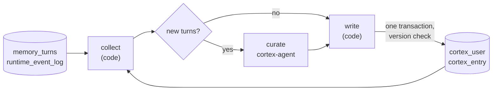

# Cortex

A user tells a concierge agent on Monday that they work at Acme and want distances in kilometres. On Thursday they ask a research agent in the same pool to plan a site visit. The research agent has never seen Monday's session, and its replayed history covers only the current one. Cortex is how it knows about Acme and kilometres anyway: one memory per user, kept by the host and read by every agent in the pool.

[Memory and compaction](memory-and-compaction.md) covers what one session carries forward. Cortex sits above sessions. It holds facts about a person, gathered across every agent they talked to, and it changes only when a build runs or when the application edits it.

## Turning it on

Cortex is off until a pool asks for it:

```python
pool = (
    HostBuilder()
    .agent(ConciergeAgent(), metadata=concierge_metadata)
    .agent(ResearchAgent(), metadata=research_metadata)
    .enable_cortex(profile_max_chars=4000)
    .build()
)
```

`enable_cortex()` does three things. It records `CortexSettings` on the pool, registers a built-in `cortex-agent`, and registers the `cortex-build` workflow. Every agent computer imports the same `build_pool()`, so each one sees the setting when `mash agent serve` builds its runtime.

## Who the user is

Memory per user needs a user the runtime can trust. H2A 0.5.0 added `user_id` to requests. The application sends it to the host with the message:

```bash
curl -X POST http://127.0.0.1:8000/api/v1/hosts/assistant/request \
  -H "Content-Type: application/json" \
  -d '{"message": "plan a site visit", "session_id": "s-7", "user_id": "u-42"}'
```

The host is the trust boundary. The application authenticates to it with the API key and asserts the user, and the host passes `user_id` to the primary's computer unchanged. It is stored on the request and on every turn the request saves, and it is never shown to the model.

Subagent calls are where an agent could try to act as someone else. A primary calls its subagents through the host's `/h2a` relay, and the relay looks up the parent request before forwarding anything:

```python
# src/mash/api/routes/h2a.py
identity = await store.get_request_identity(str(parent.get("request_id")))
if identity is None:
    return _h2a_error(400, "INVALID_PARENT", "parent request not found")
if identity.agent_id != caller:
    return _h2a_error(
        403, "FORBIDDEN", f"parent request does not belong to agent '{caller}'"
    )
if "user_id" in body and body.get("user_id") != identity.user_id:
    return _h2a_error(
        403, "FORBIDDEN", "user_id must match the parent request's user"
    )
```

The forwarded request gets `identity.user_id`, read from `runtime_request`, which records each request's agent and user from its accepted event. The subagent works for the same user as the primary.

## What an agent sees

When a request with a `user_id` reaches a computer in a Cortex pool, the runtime does two things for that request only.

The `context.load` step appends the user's profile to the system prompt:

```python
# src/mash/runtime/engine/steps.py: load_request_context
cortex = runtime.get_cortex()
if cortex is not None and user_id:
    # Read inside this checkpointed step, so a replay sees the profile the
    # request originally saw.
    system_prompt = append_context_block(
        system_prompt, await cortex.profile_block(user_id)
    )
```

The block opens with `ABOUT THIS USER` and is capped at `profile_max_chars`, with a `[profile truncated]` marker past it. An empty profile adds nothing.

The agent built for each turn also gets `search_cortex`, a read-only tool over the user's entries. The user comes from the request, never from the model's arguments:

```python
# src/mash/agents/cortex/tools.py: CortexReader.search_tool
entries = await store.search_entries(user_id, query, limit=max(1, limit))
```

A `user_id` the model puts in the arguments is ignored, and the tool's output does not include the user id. A request without a user gets neither the block nor the tool.

These reads run in the runtime's `mash` process, which holds the database credentials. The agent's bash runs as the `agent` user with a clean environment and cannot reach Postgres. The only way an agent sees memory is the block and the tool, and both are cut to one user.

## The tables

Cortex lives in two tables, from migrations `005_cortex.sql` and `006_cortex_last_build.sql`:

- `cortex_user`: one row per user with the `profile`, `built_through` (the `created_at` of the newest turn the last build covered), a `version` that every write increases, and `last_build` (the last build's run id and result).
- `cortex_entry`: the facts behind the profile. Each has a `topic`, `content`, `origin` (`build` or `app`), and `sources`, the agent, session and trace it came from.

The profile is a summary for the prompt. Entries are the detail the tool searches.

## Building a Cortex

Nothing writes Cortex when a request completes. A build runs only when something starts it:

```bash
curl -X POST http://127.0.0.1:8000/api/v1/workflow/cortex-build/run \
  -H "Content-Type: application/json" \
  -d '{"input": {"user_id": "u-42", "limit": 200}}'
```

`cortex-build` is a three-step workflow on the same layer as [masher's](synthetic-evals.md):



**collect** loads the user's Cortex and their turns since `built_through`. `MemoryStore.list_user_turns` takes turns across every agent, oldest first, and leaves out workflow turns and subagent turns: the subagent's message is the primary's delegation prompt, and what the subagent did already shows in the primary's trace. For each turn, collect reads the tools it ran from the event log. Arguments come from the `runtime.llm.think.completed` event and results from the tool and subagent completion events. It clips messages to 4000 characters, arguments to 500 and results to 1000, keeps 20 tool calls per turn, and stops adding turns at 60000 characters. The rest wait for the next run. Results of `search_cortex` itself are dropped, so memory is never built from memory.

**curate** sends the bundle to `cortex-agent`, a tool-less agent whose structured output is a new `profile`, a list of `upserts` and a list of `deletes`. With no new turns it passes the bundle through and the model never runs. Its prompt tells it to keep facts the user stated or confirmed, merge duplicates, delete build entries the new turns contradict, and cite each entry's sources.

Curate is an orchestration code step that submits one agent request, not an `AgentStep`. An agent step would always call the model, and each step only sees the previous step's output, so `write` would lose the version `collect` read. Curate carries it through in its typed output. The request id is fixed by run and task, so a replayed step reattaches to the same request.

**write** applies the result in one transaction:

```python
# src/mash/agents/cortex/store.py: CortexStore.apply_build
if last_build.get("run_id") == run_id:
    return dict(last_build["result"])
if int(row["version"]) != base_version:
    raise CortexConflictError(
        f"cortex for user '{user_id}' changed since the build read it"
    )
```

The version check makes a build a compare-and-set. If the application edited the user's Cortex while the model was curating, the write raises `CortexConflictError`, the run fails, and a rerun starts from a fresh read. The `last_build` check covers the other side: a write retried after its transaction committed finds its own run id and returns the stored result.

The result reports `turns_covered`, `entries_written`, `entries_deleted` and `remaining`. A caller reruns until `remaining` is 0. Running it when a session ends is enough for most applications.

## What the application controls

The application can read and change any user's Cortex under `/api/v1/cortex/users/{user_id}`:

| Route | Does |
|---|---|
| `GET /cortex/users/{user_id}` | Profile, watermark, version, entry count |
| `GET /cortex/users/{user_id}/entries` | Entries newest first, with `q`, `origin`, `limit`, `after` |
| `POST /cortex/users/{user_id}/entries` | Create an entry from `topic` and `content` |
| `PATCH /cortex/users/{user_id}/entries/{entry_id}` | Change an entry's topic or content |
| `DELETE /cortex/users/{user_id}/entries/{entry_id}` | Delete one entry |
| `DELETE /cortex/users/{user_id}` | Delete the user's whole Cortex |

An entry the application creates or edits gets `origin: app` and is pinned. Builds see pinned entries as fixed facts in the curator's input, and `apply_build` skips any upsert or delete that targets one. An application that knows the user's plan from its billing system writes it once, and no build will overwrite it.

The profile has no route. Builds write it from the turns and the entries, pinned ones included, so the application shapes it by editing entries and running a build.

Deletes are permanent for turns already built. The watermark is past them, so the next build does not learn a deleted fact again from the same conversation. Deleting the whole Cortex removes the row and its watermark, and the next build starts from the user's first turn.

## Conversation search follows the user

The same `user_id` also scopes the older runtime tools. `search_conversations` offers scope `user`, the user's sessions with that agent, only on a request with a user, and `get_full_turn_message` returns only that user's turns. Without a user both tools stay inside the current session. An agent in a Cortex pool reaches its own user's history and no one else's.

For running a pool with Cortex in production, including the `CORTEX_AGENT_<PROVIDER>_MODEL` setting, see the [deploy guide](how-to-deploy.md).
