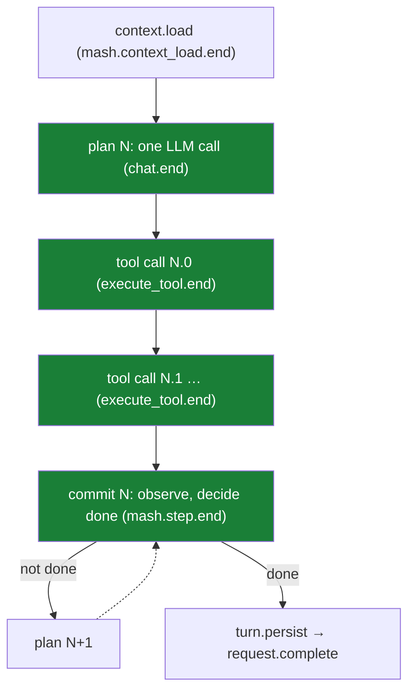

# The Durable Agent Loop

The agent loop in Mash is a think/act/observe cycle. Almost everything the agent does flows through tool calls — skills, child requests, remote tools, memory — and the loop runs the same way regardless of which of those is happening.

A trace spans one user message through the full loop run to the final response, written as one row in `memory_turns` on completion. Within a trace, each iteration of the loop is a turn — one think/act/observe cycle.

The runtime runs each request as a loop whose only record is the event log in Postgres. Every model call, tool call and commit appends its output there. If the agent's process crashes mid-run, the host restarts it, the request's state is rebuilt from its events, and the loop runs only the work that has no recorded end.

## The loop

In the **think** phase, the model receives the current context and returns an action — either a set of tool calls to execute, or a final response signalling the run is complete. In the **act** phase, if the action has tool calls they execute; if not, act returns nothing. In the **observe** phase, results fold back into context. The loop continues as long as the model returns tool calls, or until `max_steps` is reached.

The loop in `mash/core/agent.py` maps directly to those phases:

```python
# src/mash/core/agent.py: Agent.run() (trimmed)
for step in range(self.config.max_steps):
    plan = await self.plan_step(context)      # think: one LLM call → an Action
    results = await self.act(plan.action)     # act: execute tool calls, or [] if none
    commit = self.commit_step(                # observe: fold results into context,
        context, plan.action, results,        # decide whether we're done
        step_index=step,
    )
    context = commit.context
    if commit.done:
        break
```

## Tool calls as the uniform interface

The LLM emits tool calls during `plan_step`. The `act` phase executes them. What those calls do covers a wide range:

- **Skills** — a `Skill` meta-tool fetches the relevant markdown instruction bundle and surfaces it back to the LLM as a tool result
- **Routing**: the companion's `RunSubAgents` sends one or more requests to the host's agents, runs them at the same time and streams back their output
- **Web search and fetch** — `web_search` and `web_fetch` are registered tools when a web search provider is configured
- **Remote MCP tools** — tools registered from MCP servers (GitHub, databases, custom servers) are called the same way as local tools
- **Memory** — `memory_search` and `memory_store` read and write to the agent's memory store

From the loop's perspective, these are all tool calls. The routing happens inside `act`.

## Durability from the event log

A recovered request continues from what its events record, so how much a step records decides the cost of recovery. If the loop recorded nothing until the end, a crash mid-run would replay from the start: every LLM call billed again, every tool call executed again. For agents that write to external systems, that matters.

Each step appends its output as events with dedupe keys: `chat.end` for the LLM call (the assistant's blocks and tool calls), `execute_tool.end` for each tool call (its full result), and `mash.step.end` for the commit. The loop holds its state in memory while it runs and writes nothing else. A request picked up after a crash rebuilds the state from its events:

```python
# src/mash/runtime/engine/loop.py: RequestRun._run (trimmed)
state = await rebuild_request_state(runtime, ..., events=await store.list_request_events(request_id))
if state is None:                           # no context load recorded yet
    state = await load_request_context(...)
while not state.get("done"):
    if state.get("action") is None:        # no chat.end for this step
        state = await retry_transient(lambda: plan_request_step(...))
    state = await self._act(state)          # runs the calls with no execute_tool.end
    state = await commit_request_step(...)
```

The rebuild applies the events with the same functions the running loop uses, `apply_plan` for a `chat.end` and `commit_state` for a committed step, so it arrives at the state the loop held. `mash.context_load.end` records the system prompt as rendered and the turns the request replayed, so the rebuilt context is the one the request first saw. In a parallel batch each call has its own `execute_tool.end`, so only the calls without one run again.



Each green box ends with an event. A crash between any two of them resumes at the boundary. Re-running a plan costs one extra LLM call with no side effects. A tool call that has its `execute_tool.end` does not run again.

The loop carries its execution state in one dict:

| Field | What it holds |
|---|---|
| `context` | the serialized model context, updated after every plan and commit |
| `loop_index` | which turn of the loop we're on |
| `action` | the planned action for the current turn (tool calls to run) |
| `result_payloads` | completed tool results for the current turn |
| `aggregate_usage`, `tool_usage` | token accounting across the run |
| `done` | whether `commit_step` declared the run terminal |

Nothing here is written to `memory_turns` until the trace completes. Partial progress lives in the event log until then.

## Cancel

A request runs until it ends or someone cancels its event: `POST /api/v1/sessions/{session_id}/events/{event_id}/cancel`. The host cancels the event's request on the companion and every `RunSubAgents` child still running under it, each through its own agent.

Cancel stops a running request at the next step boundary. The step in flight finishes and appends its events first, so a tool call that already started completes and its result is recorded. A request parked on an approval or `AskUser` has that interaction acked as cancelled and the tool call terminated.

One request's event log, cancelled while the LLM call after the seventh tool call was in flight:

```
seq  event_type                     detail
40   execute_tool.start             sleep 3 && echo step-7
41   execute_tool.end               ok
42   mash.step.end
43   chat.start
44   invoke_agent.end               cancelled
45   chat.end
```

Seq 44 is where the cancel landed. The model call that was already running finished and recorded its result, which is why its `chat.end` sits after the cancelled `invoke_agent.end`. Terminality reads the last lifecycle event for a request, so the trailing `chat.end` leaves the request cancelled and its stream closes. A cancelled or failed request stays ended. Trying again means posting the message as a new event, which runs as a new request against the session as it stands.

## Event sourcing

Every plan, tool call, and commit emits structured events to the `runtime_event_log` table. Those events are how the runtime recovers a request, how the streaming API works (a client reading an event's stream is reading from that log), and how the runtime provides observability into a run.

The events are the same regardless of which LLM provider runs the think step. All providers (Anthropic, OpenAI, Gemini, and OSS models via `OSSCompatibleProvider`) implement the same `send(LLMRequest) -> LLMResponse` interface. The loop works only with `LLMResponse`, so `chat.end` carries the same fields whether Claude or a self-hosted Qwen model produced the plan, with the provider and model as its `gen_ai.provider.name` and `gen_ai.request.model` attributes. Swapping providers is a change to `build_llm()`; the events, the tooling, and the loop are unaffected.

You can query the log after the fact to see exactly what happened in a session:

```sql
select seq, event_type, loop_index, payload
from runtime_event_log
where session_id = 'd8ec0a00-20df-48dc-a90b-9aa1b8393f8b'
order by seq;
```

The event log holds both what the runtime needs to continue execution and the record of what happened. The completed trace is also written as a turn to a second store, `memory_turns`. That split is covered in the next post.

## Failure handling

Three layers cover different failure modes:

| Failure | Handled by | You do |
|---|---|---|
| Transient error (rate limit, timeout, network blip) | `retry_transient()`: in-process retry with exponential backoff and jitter, three retries after the first attempt | nothing |
| Retries exhausted, or terminal error (bad API key, context overflow) | the loop emits `request.error` with `error_code` and `retryable` | inspect; post the message again as a new event |
| Process crash (OOM, `kill -9`, hardware) | the restarted process rebuilds the agent's running requests from their events and continues them; after 10 recoveries a request fails | nothing |

The first layer wraps LLM planning and tool execution and classifies errors by pattern:

```python
# src/mash/runtime/errors.py (trimmed)
_RETRYABLE_PATTERNS = (
    (("rate_limit", "429", "too many requests"), "rate_limit_exceeded"),
    (("timeout", "timed out", "deadline exceeded"), "timeout"),
    (("connection", "network", "dns", "socket"), "network_error"),
    ...
)
_TERMINAL_PATTERNS = (
    (("authentication", "unauthorized", "401", ...), "auth_error"),
    (("context_length_exceeded",), "context_length_exceeded"),
    ...
)
```

Unknown errors default to retryable. A crashed process emits no `request.error`, so `GET .../request/{id}/status` covers that case by reading the request's status from `runtime_request`. A status of `running` means the request continues when its agent's process starts; `failed` means it will not continue on its own.

*Next: [The Runtime Store](persistence-store.md).*
