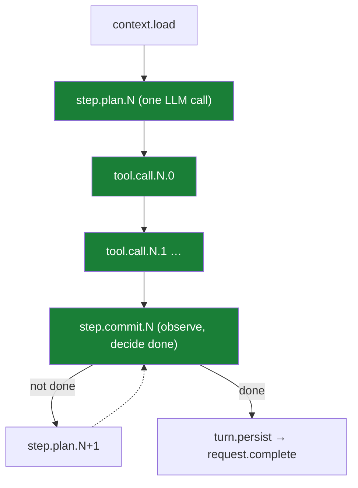

# The Durable Agent Loop

The agent loop in Mash is a think/act/observe cycle. Almost everything the agent does flows through tool calls — skills, subagents, remote tools, memory — and the loop runs the same way regardless of which of those is happening.

A trace spans one user message through the full loop run to the final response, written as one row in `memory_turns` on completion. Within a trace, each iteration of the loop is a turn — one think/act/observe cycle.

The runtime runs each request as a loop that checkpoints to Postgres. The LLM call and the commit are each a checkpoint; each tool call gets its own checkpoint. If the agent's process crashes mid-run, the host restarts it and the request continues from the last completed checkpoint.

## The loop

In the **think** phase, the model receives the current context and returns an action — either a set of tool calls to execute, or a final response signalling the run is complete. In the **act** phase, if the action has tool calls they execute; if not, act returns nothing. In the **observe** phase, results fold back into context. The loop continues as long as the model returns tool calls, or until `max_steps` is reached.

The loop in `mash/core/agent.py` maps directly to those phases:

```python
# src/mash/core/agent.py: Agent.run() (trimmed)
for step in range(self.config.max_steps):
    plan = await self.plan_step(context)      # think: one LLM call → an Action
    results = await self.act(plan.action)     # act: execute tool calls, or [] if none
    commit = self.commit_step(                # observe: fold results into context,
        context, plan.action, results,        # decide whether we're done
        step_index=step,
    )
    context = commit.context
    if commit.done:
        break
```

## Tool calls as the uniform interface

The LLM emits tool calls during `plan_step`. The `act` phase executes them. What those calls do covers a wide range:

- **Skills** — a `Skill` meta-tool fetches the relevant markdown instruction bundle and surfaces it back to the LLM as a tool result
- **Subagent invocation** — `RunSubAgents` sends one or more requests to other agents in the pool, or to the agent itself, runs them at the same time and streams back their output
- **Web search and fetch** — `web_search` and `web_fetch` are registered tools when a web search provider is configured
- **Remote MCP tools** — tools registered from MCP servers (GitHub, databases, custom servers) are called the same way as local tools
- **Memory** — `memory_search` and `memory_store` read and write to the agent's memory store

From the loop's perspective, these are all tool calls. The routing happens inside `act`.

## Checkpoint-level durability

A recovered request continues from its last completed checkpoint, so the granularity of checkpoints determines the cost of recovery. If the whole loop were one checkpoint, a crash mid-run would replay from the start: every LLM call billed again, every tool call executed again. For agents that write to external systems, that matters.

The runtime saves a checkpoint after each step of a loop iteration: after the LLM call (`step.plan.N`), after each tool call (`tool.call.N.M`; parallel-safe calls may run together as one `tool.batch.N.M`), and after the commit (`step.commit.N`). A checkpoint is the request's loop state, written over the previous one in its `runtime_request` row. In code:

```python
# src/mash/runtime/engine/loop.py: RequestRun._run (trimmed)
while not state.get("done"):
    if state.get("action") is None:        # not planned yet
        state = await retry_transient(lambda: plan_request_step(...))
        await self._save(state)
    state = await self._act(state)          # runs the calls with no result yet,
                                            # saving after each one
    state = await commit_request_step(...)
    await self._save(state)
```

`_act` starts at `len(state["result_payloads"])`, so on recovery it skips the calls whose results are already in the checkpoint. Execution picks up at the first tool call that did not complete.



Each green box is a checkpoint. A crash between any two of them resumes at the boundary. Re-running `step.plan.N` costs one extra LLM call with no side effects. Re-running a tool call that already completed is prevented by the index check.

The loop carries all execution state in one dict, the checkpoint's `state`:

| Field | What it holds |
|---|---|
| `context` | the serialized model context, updated after every plan and commit |
| `loop_index` | which turn of the loop we're on |
| `action` | the planned action for the current turn (tool calls to run) |
| `result_payloads` | completed tool results for the current turn; the resume cursor |
| `aggregate_usage`, `tool_usage` | token accounting across the run |
| `done` | whether `commit_step` declared the run terminal |

Nothing here is written to `memory_turns` until the trace completes. Partial progress lives in the checkpoint and the event log until then.

## Cancel, resume, and rerun

The replay that recovers a crashed process also gives a person control over a request that is running or already finished. Three verbs sit on the API: `POST .../request/{request_id}/cancel`, `.../resume`, and `.../rerun`.

Cancel stops a running request at the next step boundary. The step in flight finishes and checkpoints first, so a tool call that already started completes and its result is recorded. A request parked on an approval or `AskUser` has that tool call terminated. A subagent invocation is a tool call like any other: a child that has already been invoked runs to completion, and cancel never cascades to it.

Resume continues a cancelled or failed request from its last checkpoint; a failed one runs its failed step again. All of its context comes from the checkpoints, so the request picks up with the model context as it stood rather than one rebuilt from the original message. A request whose session has accrued a later turn is rejected with a 409, because resume replays the original context snapshot and allowing it would persist a turn that ignores everything after it. A request cancelled while parked on an interaction resumes by issuing a fresh `AskUser` call under a new interaction id.

Rerun starts a previous request over as a new request, with a new request id, a new trace, and a `rerun_of` key stamped into the request metadata for provenance. The original message and host snapshot ride along, and `context.load` runs fresh against the session as it stands now.

One request's event log across a cancel and a resume, cancelled while the LLM call after the seventh tool call was in flight:

```
seq  event_type                     detail
40   execute_tool.start             sleep 3 && echo step-7
41   execute_tool.end               ok
42   mash.step.end
43   chat.start
44   invoke_agent.end               cancelled
45   chat.end
46   mash.request.resumed
47   execute_tool.start             sleep 3 && echo step-8
```

Seq 44 is where the cancel landed. The model call that was already running finished and checkpointed, which is why its `chat.end` sits after the cancelled `invoke_agent.end`. Resume at 46 reads the checkpoint and execution continues at the eighth tool call. No work between step-7 and step-8 ran twice.

Because terminality reads the last lifecycle event for a request, `mash.request.resumed` returns a cancelled request to non-terminal, and a client whose stream ended reopens it. Trace and request are one to one, so the admin UI hangs these three actions off the Logs trace view and addresses the request by its trace id.

## Event sourcing

Every plan, tool call, and commit emits structured events to the `runtime_event_log` table alongside the checkpoint. Those events are how the streaming API works: a client polling `GET .../request/{id}/events` is reading from that log. They are also how the runtime provides observability into a run.

The events are the same regardless of which LLM provider runs the think step. All providers (Anthropic, OpenAI, Gemini, and OSS models via `OSSCompatibleProvider`) implement the same `send(LLMRequest) -> LLMResponse` interface. The loop works only with `LLMResponse`, so `chat.end` carries the same fields whether Claude or a self-hosted Qwen model produced the plan, with the provider and model as its `gen_ai.provider.name` and `gen_ai.request.model` attributes. Swapping providers is a change to `build_llm()`; the events, the tooling, and the loop are unaffected.

You can query the log after the fact to see exactly what happened in a session:

```sql
select seq, event_type, loop_index, payload
from runtime_event_log
where session_id = 'd8ec0a00-20df-48dc-a90b-9aa1b8393f8b'
order by seq;
```

The event log and the checkpoint are separate. The checkpoint holds what the runtime needs to continue execution; the event log holds the record of what happened. The completed trace is written to a third store. That split is covered in the next post.

## Failure handling

Three layers cover different failure modes:

| Failure | Handled by | You do |
|---|---|---|
| Transient error (rate limit, timeout, network blip) | `retry_transient()`: in-process retry with exponential backoff and jitter, three retries after the first attempt | nothing |
| Retries exhausted, or terminal error (bad API key, context overflow) | the loop emits `request.error` with `error_code` and `retryable` | inspect; call `POST .../resume` to retry the failed step, or `.../rerun` to start over |
| Process crash (OOM, `kill -9`, hardware) | the restarted process continues the agent's running requests from their checkpoints; after 10 recoveries a request fails | nothing |

The first layer wraps LLM planning and tool execution and classifies errors by pattern:

```python
# src/mash/runtime/errors.py (trimmed)
_RETRYABLE_PATTERNS = (
    (("rate_limit", "429", "too many requests"), "rate_limit_exceeded"),
    (("timeout", "timed out", "deadline exceeded"), "timeout"),
    (("connection", "network", "dns", "socket"), "network_error"),
    ...
)
_TERMINAL_PATTERNS = (
    (("authentication", "unauthorized", "401", ...), "auth_error"),
    (("context_length_exceeded",), "context_length_exceeded"),
    ...
)
```

Unknown errors default to retryable. A crashed process emits no `request.error`, so `GET .../request/{id}/status` covers that case by reading the request's status from `runtime_request`. A status of `running` means the request continues when its agent's process starts; `failed` means it will not continue on its own.

*Next: [The Runtime Store](persistence-store.md).*
