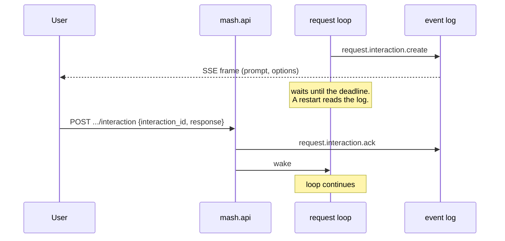

# Human-in-the-Loop

An agent plans to call a deploy tool that needs consent, then has a follow-up question about which environment to target. The user who can answer is in a meeting for the next three hours, and somewhere in that window the host gets redeployed.

In Mash both pauses are durable. The request resumes after the restart, still waiting, and when the user answers, execution continues from exactly where it paused, whether that takes seconds or days. This post covers the two ways an agent pauses for a person and the single mechanism underneath both.

## The tool contract

The contract between a Mash agent and its tools is four attributes and a method:

```python
# src/mash/tools/base.py
class Tool(Protocol):
    name: str
    description: str
    parameters: Dict[str, Any]   # JSON schema
    requires_approval: bool

    async def execute(self, args: Dict[str, Any]) -> ToolResult: ...
```

`requires_approval` is the human-in-the-loop entry point. A tool that deploys services or sends messages gets gated behind user consent with one line:

```python
class DeployTool:
    name = "deploy_service"
    requires_approval = True
    ...
```

After each plan step, the workflow checks the planned tool calls against `registry.tools_requiring_approval(names)`. If any match, the action carries an approval interaction and the engine pauses durably before the tool phase. The user answers `approve`, `deny`, or `skip`.

On a denial, the workflow synthesizes an error result for each pending call and hands it back to the model like any other tool outcome, and the request keeps going:

```python
# src/mash/runtime/engine/loop.py (trimmed)
denied = {
    "tool_call_id": tool_call.id,
    "tool_name": tool_call.name,
    "result": {
        "content": f"Tool execution denied by user ({response})",
        "is_error": True,
        "metadata": {"denied": True},
    },
}
```

The agent observes the denial in its next think phase and can adjust or propose something else, the same way it would react to any failed tool call.

## AskUser never executes

The second pause is agent-initiated. `AskUser` is a built-in tool the agent calls when it needs information to continue, and in the hosted runtime its `execute()` method is dead code: the workflow recognizes the call by name and routes around it.

```python
# src/mash/runtime/engine/loop.py (trimmed)
if name == "AskUser":
    return await self._ask_user(state, tool_call=tool_call, loop_index=loop_index)
```

The interception exists for durability. The tool's purpose is to wait for a human, and a plain `await` inside `execute()` would hold that wait in process memory, where one restart would lose the question. The workflow translates the call into a durable interaction instead, and when the answer arrives, it hands the agent an ordinary `ToolResult` whose content is the user's response. As far as the model is concerned, `AskUser` is a tool that works like any other. (Outside a hosted runtime, calling it returns an error result saying it only works hosted.)

## Interaction types

Every interaction, whether the runtime or the agent initiated it, is one of three types, each with a defined answer shape and timeout default:

| Type | Created by | Response shape | On timeout |
|---|---|---|---|
| `approval` | a planned tool call with `requires_approval` | `"approve"` / `"deny"` / `"skip"` | `"deny"` |
| `info` | `AskUser(question=...)` with no options | free-form string | `""` |
| `choice` | `AskUser(question=..., options=[...])` | selected option(s) | `[]` |

The timeout defaults are conservative: an unanswered approval is a denial, and `AskUser` waits up to an hour before giving up.

## The pause machinery

The whole flow is visible in `RequestRun._run_interaction`. The loop opens the interaction in a step whose result it keeps in its checkpoint, then waits for the answer:

```python
# src/mash/runtime/engine/loop.py (trimmed)
opened = await self._step(
    f"{step_prefix}.open.{loop_index}.{attempt}",
    self._open_interaction, ...,       # mints the id, appends interaction.create
)
response, timed_out = await self._await_answer(
    opened["interaction_id"], deadline=opened["deadline"], ...
)
```

The answer is an event: the interaction's `mash.interaction.end`, keyed `interaction.ack.<id>`. `_await_answer` waits in process until the deadline, then reads the log. At the deadline it appends the default answer itself (`deny` for an approval), under the same key, so an answer and a timeout that race leave one row, and both sides read it.

The process can die and restart any number of times while the request waits. The recovered loop finds the interaction's id and deadline in its checkpoint, reads the answer from the log if one arrived while it was down, and otherwise waits out the rest of the deadline.

On the wire, the client sees the pause as a pair of frames in the event stream from [the request lifecycle post](request-lifecycle.md):

```text
event: request.interaction.create   ← interaction_id, type, prompt, options, timeout
... (seconds or days) ...
event: request.interaction.ack      ← interaction_id, the response
```

And because the stream is a replay of persisted events, a client that connects while the request is paused still sees the `create` frame and can render the pending question.

## Delivering the answer

The response travels back through the same API surface the request came in on:

```bash
curl -X POST http://127.0.0.1:8000/api/v1/agent/pilot/request/7c9e…/interaction \
  -H "Authorization: Bearer $MASH_API_KEY" \
  -H "Content-Type: application/json" \
  -d '{"interaction_id": "itr_a1b2c3d4e5f6", "response": "approve"}'
```

The agent's process appends the answer as the `ack` event and wakes the waiting loop, which continues into the tool phase. An answer to an interaction that already has one, a timeout or a cancel gets `409 INTERACTION_CLOSED`.



## What the agent gets back

For an approval, the answer steers the tool phase: `approve` lets execution proceed, while `deny` or `skip` produces the synthesized error results above, and the model reasons about the refusal on its next think.

For `AskUser`, the answer comes back as the tool result:

```json
{
  "content": "staging",
  "is_error": false,
  "metadata": {"interaction_id": "itr_a1b2c3d4e5f6", "timed_out": false}
}
```

The `timed_out` flag is worth checking. A timed-out `info` interaction hands the agent an empty string, which is indistinguishable from a user who pressed enter except for that flag. An agent that asks questions should handle the timeout case explicitly, for example by falling back to a stated default instead of treating silence as an answer, and the system prompt is the right place to set that expectation.

## One mechanism

Approval gating and `AskUser` look like different features, but in the runtime they are the same mechanism: a `request.interaction.create` / `request.interaction.ack` pair in the log, a loop waiting on the interaction's id, and an answer delivered through `POST .../interaction`. The only difference is who initiates the pause, the runtime before a flagged tool or the agent itself.

A client that can render a prompt and POST a response handles every human-in-the-loop case Mash has, and new interaction-shaped features can reuse the same pair of events.

Everything here ran on tools registered in `build_tools()`, objects living in the agent's runtime in its process. The next post covers tools that live outside it, published by Model Context Protocol servers and discovered at startup.

*Next: [Remote Tools over MCP](remote-tools-mcp.md).*
