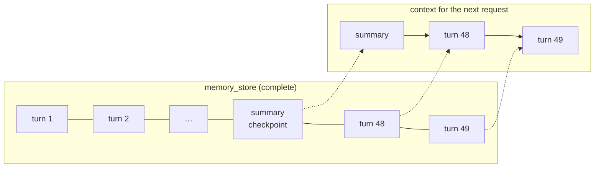

# Memory and Compaction

A session that runs for weeks accumulates hundreds of turns, while the model's context window and your token budget stay fixed. Mash's memory layer is the set of rules for deciding what the next request actually sees. It's built from turns replayed as transcripts, summary checkpoints written when the context gets large, and per-turn signals.

## What context loading actually loads

The `context.load` step from [the durable loop post](durable-agent-loop.md) asks the memory store for the session's latest **summary checkpoint** and every turn after it:

```sql
-- memory_turns, through idx_memory_turns_session_order
WITH summary AS (latest replayable summary_checkpoint of the session)
SELECT ... FROM memory_turns
WHERE session_id = $1 AND agent_id = $2 AND replayable
  AND (no summary OR (created_at, trace_id) >= the summary's)
ORDER BY created_at, trace_id
```

A summary checkpoint is a turn whose content is a generated summary of everything before it. When one exists, context becomes the summary plus the turns after it. The full early history is still in the store, but it stops being loaded.

Each turn after the checkpoint is replayed in the form the agent's `AgentConfig.replay` picks:

| `replay` | What a turn becomes |
|---|---|
| `transcript` (default) | its messages rebuilt from the event log: the user message, each step's assistant blocks and tool calls as the model wrote them, and each tool result |
| `replies` | its user message and reply, with the agent sessions behind the reply before the next message (the companion) |
| `none` | nothing |

A transcript comes from the turn's `invoke_agent.start`, `chat.end` and `execute_tool.end` events, read for every replayed turn in one query on the trace index. An agent continuing a session sees what it fetched and what it changed there, not only what it said. A tool result longer than `tool_result_context_chars` was saved to a file in the agent's sandbox when it ran, and replays as the same note the request showed, naming the file for the model to read with `run_code`.

Not every turn is a candidate. A workflow run's turns share a session without being part of a conversation, so they are persisted as **non-replayable** and skipped here, and pipeline work never crowds the context. The companion's `RunSubAgents` children run in sessions of their own: each replays its own agent's earlier work, and the companion keeps the routes to their sessions instead of their turns.



## Compaction: who writes the checkpoint

Checkpoints come from compaction, the runtime summarizing earlier turns using the agent's own LLM. It triggers two ways.

Automatically: each turn records `context_tokens`, the size of the context its last model call read and wrote: all of its input, cached included, plus its output. Each provider reports it, since they differ in whether their input count includes cached input (Anthropic's does not). Before building context the runtime compares the latest turn's to the threshold:

```python
# src/mash/runtime/context.py: build_context_payload (trimmed)
threshold = self.agent.config.compaction_token_threshold
if threshold > 0 and await get_context_tokens(self, session_id) >= threshold:
    summary_text, summary_turn_id = await compact_session(self, session_id, reason="auto")
```

Manually: `POST /api/v1/agent/{agent_id}/sessions/{session_id}/compact` does the same on demand. This is useful when you know a session just finished a phase and the detail won't matter again.

The summary reads the history a request would replay, rendered as text: user messages, replies, tool calls and their results. The knobs live in `AgentConfig`:

| Field | Default | Meaning |
|---|---|---|
| `compaction_token_threshold` | `500_000` | the latest turn's context size that triggers compaction (`0` turns it off) |
| `compaction_temperature` | `0.0` | sampling for the summary call |

Summaries are generated at temperature zero because they are records, not prose. The summarization prompt aims to preserve decisions, constraints, user preferences, and the ids of agent sessions the user may come back to, the things a future turn might silently depend on, and discard the conversational scaffolding around them. Compaction is lossy; [the runtime store post](persistence-store.md) covered why memory can afford that and the event log can't. When the loss matters, the original turns are still in the store, and there's a path back to them.

## Signals

Every persisted turn carries **signals**, small structured values collected when the run completes: token counts, tool activity, and whatever the runtime's signal collectors compute. They're stored per turn, alongside the message text:

```text
GET /api/v1/agent/pilot/sessions/s1/signals

definitions: { "tokens.total": {...}, "tools.invocations": {...}, ... }
turns: [ { "turn_id": "…", "created_at": …, "signals": {"tokens.total": 8412, ...} } ]
```

Signal values are persisted rows, while signal definitions are runtime-owned metadata returned alongside them, so readers always interpret values against the exact signal set the runtime computes. Signals are how you ask operational questions across sessions ("which sessions burned the most tokens," "where did tool errors cluster") with a query over structured rows instead of a pass over transcripts.

## Search: the path back

Bounded context means the agent's working memory forgets things that the store still has. Two runtime tools, registered automatically on hosted agents, give the agent itself a way back into its history:

- `search_conversations` runs keyword search over stored turns (Postgres full-text on the message columns) and returns ranked previews with turn ids.
- `get_full_turn_message` expands a hit into the complete turn text.

The two-step shape follows the same economics as [skills](skills-on-demand.md): previews are cheap to put in front of the model, so it sees those first and pays for full text only on the turns it chooses. A user can ask "what did we decide about the schema migration last month?" and the agent can answer from a session whose early turns were compacted away fifty turns ago.

## Per-agent scoping

Everything above is scoped by `agent_id`. Every read and write carries it, so an agent's memory is its own even when several agents share a store. Search is also scoped by app: every request carries the `app_id` of the application that posted its event, and it can search the agent's other conversations in that app. That matters in the next post, where a host runs several agents, each in its own process, and the built-in companion routes between them.

*Next: [Composing Agents Under One Host](composing-agents.md).*
