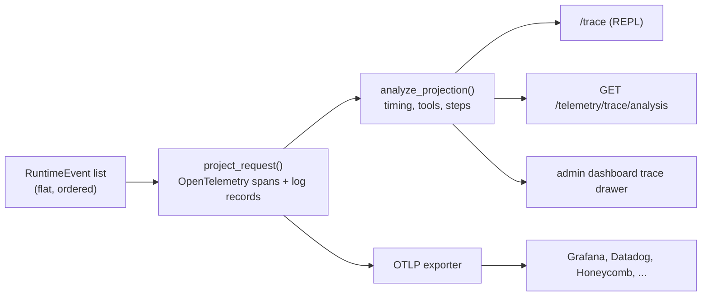

# Reading a Trace

Every post in this series ended up at the same place, events in an append-only log. This one is about reading them back out: turning the flat event stream of one request into an answer to where the time went.

The pipeline has three stages:



All of it is pure computation over event timestamps and payloads. Project the same request twice and you get the same spans with the same ids, which matters when the output is what you'll use to argue about latency.

## From events to spans

Each event a request writes is named after the span it bounds: `invoke_agent.start` and `invoke_agent.end` for the run, `chat.start` and `chat.end` for a model call, `execute_tool.start` and `execute_tool.end` for a tool call. Spans OpenTelemetry has no name for use `mash.*`: `mash.context_load`, `mash.step`, `mash.interaction`. Each event also carries its OpenTelemetry attributes under `attributes`, with their GenAI convention names, so `chat.end` stores `gen_ai.request.model` and `gen_ai.usage.input_tokens` as they are.

`project_request(events)` in `mash/otel/projection.py` pairs each start with its end and returns spans and log records. A typical request becomes:

```text
invoke_agent assistant                   4.81s
├── mash.cold_start                      120ms   accepted → context load starts
├── mash.context_load                     85ms   history + summary loaded
├── mash.step 0
│   ├── chat claude-sonnet-4-6           1.4s    gen_ai.usage.* attributes
│   └── execute_tool run_code            640ms
├── mash.step 1
│   ├── chat claude-sonnet-4-6           1.1s
│   └── execute_tool RunSubAgents        1.2s
│       └── invoke_agent cli-copilot     1.1s    the child, in this trace
└── mash.step 2
    └── chat claude-sonnet-4-6           260ms   final response
```

Two spans measure gaps. `mash.cold_start` runs from `invoke_agent.start` to `mash.context_load.start`, the cost of the engine picking the request up, which the [lifecycle post](request-lifecycle.md) showed are two separate events for this reason. Whatever time inside the trace no span claims gets reported as **idle**: gaps between steps, scheduling overhead, anything unaccounted for. A request that feels slow despite fast model calls and fast tools shows its problem in cold start or idle, which are host-side numbers.

A span whose end is not stored yet comes back open. The admin UI shows a running request as a tree whose open spans say `running`, and a request waiting on an approval as an open `mash.interaction approval` span under its step.

Facts that happen at a point in time become log records with the trace id and span id of the span they fall inside. A failure is an `exception` record on the span that failed: a tool that errored, or, when the request itself fails, the innermost span still open, which the projection also closes as an error. Resuming a request and switching it between foreground and background are `mash.request.resumed` and `mash.request.mode_changed` records on the root.

## From spans to answers

`analyze_projection(projection)` reduces the spans to a few summaries:

- **Timing breakdown**: total duration split across cold start, context load, model calls, tools, subagents, and idle, each with absolute and percentage values.
- **Per-tool stats**: call count, total/avg/max/min latency, error count, sorted by total time so the most expensive tool reads first.
- **Per-step breakdown**: model call vs. tool vs. overhead for each loop iteration. The shape tells you whether a request was slow because of one bad step or uniformly heavy.
- **Slowest operations**: top spans by duration.

Delegation costs flow through the tree. A `RunSubAgents` call's `execute_tool.start` lists the request id of each child it started, and the projection nests each child's `invoke_agent` span, built from the child's own log, under that call. The analysis treats a child's spans as the child's: each one gets its own analysis, attached to the parent's, so a slow primary request whose time went into a subagent's tool call attributes the cost to that tool.

## Where the analysis renders

The analysis renders in three places, all backed by the same computation.

In the REPL, `/trace` analyzes the most recent trace (or `/trace 5` for the last five): summary line, timing table with bars, tool stats, and slowest operations, right in the terminal. It fits the development loop, since you can type `/trace` the moment a reply feels slow and see the breakdown while the request is still fresh.

Over HTTP, `GET /api/v1/telemetry/trace/analysis?agent_id=…&session_id=…&trace_id=…` returns the projection and the full analysis dict in one call, which suits dashboards, alerts, and regression checks in CI. The trace id to query for is sitting on each turn in memory, since [trace id doubles as turn id](persistence-store.md).

In the browser, the admin dashboard at `/admin` renders the trace under Logs: a request list per agent, and a drawer per trace with summary tiles, the reconstructed conversation, and the spans with their durations. A click on a span shows its attributes and log records. This is the view for browsing and reading traces, where a terminal table stops scaling.

## Exporting over OTLP

The same projection goes to any OpenTelemetry backend. Install the extra and point the host at a collector:

```bash
uv add 'mashpy[otel]'
export OTEL_EXPORTER_OTLP_ENDPOINT=http://collector:4318
export OTEL_SERVICE_NAME=assistant
```

The exporter runs in the host. It tails the event log and, when a request's `invoke_agent.end` is stored, projects the request and sends its spans and log records over OTLP, along with the two GenAI client metrics, `gen_ai.client.token.usage` and `gen_ai.client.operation.duration`. Its position lives in a one-row table, so a restart picks up where it stopped. A `RunSubAgents` child goes out with its root, and a request a workflow step submitted goes out with the run, as a child of that step's span in a `mash.workflow <workflow_id>` trace.

A caller that sends a W3C `traceparent` header on submit gets the request inside its own trace: the root `invoke_agent` span takes the caller's span as its parent.

Prompts, completions and tool arguments and results stay out of the export unless `MASH_OTEL_CAPTURE_CONTENT=1` is set. With it, each model call adds a `gen_ai.client.inference.operation.details` record with its output messages, and tool spans carry `gen_ai.tool.call.arguments` and `gen_ai.tool.call.result`.

## Wrapping up

The event log was introduced in the first post as the record of what happened, and this post read that record directly; the same events that drive SSE replay drive the latency breakdown and the export. That closes the tour of the internals. From here, the [CLI guide](building-agent-clis.md) puts a custom shell on top of what you've built, and the [deploy guide](how-to-deploy.md) covers running it in production.
