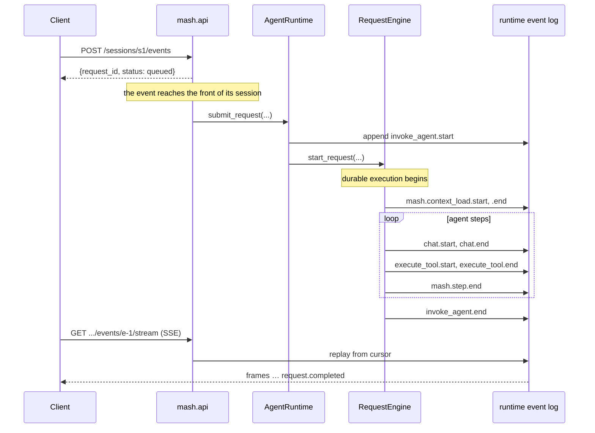

# The Life of a Mash Request

Posting a message to a host returns a request id:

```bash
curl -X POST http://127.0.0.1:8000/api/v1/sessions/s1/events \
  -H "Authorization: Bearer $MASH_API_KEY" \
  -H "Content-Type: application/json" \
  -d '{"event_id": "e-1", "host_id": "pilot", "app_id": "pilot-cli",
       "policy_id": "dev", "message": "What changed in the last five commits?"}'
```

```json
{
  "data": {
    "session_id": "s1",
    "event_id": "e-1",
    "request_id": "7c9e1f0a-…",
    "seq": 1,
    "status": "queued"
  }
}
```

The message is an event in session `s1`. The host queues it behind any earlier event in the session, and when its turn comes it runs as one request on the host's built-in companion, which routes it among the host's agents (see [composing agents](composing-agents.md)). The `request_id` is derived from the session and event ids, so it is known before the request starts. The response above is trimmed; it also carries the event's open interactions, its response or error once it ends, and timestamps.

The answer arrives as a stream of events on `GET /api/v1/sessions/s1/events/e-1/stream`, ending in a `request.completed` frame that carries the response text. This post follows one request from submission to completion and walks through the events the runtime emits along the way.

## Post, then stream

Mash splits the interaction into two calls so that accepting a request and watching its progress stay independent. The host accepts the event, makes it durable, and lets you attach to its progress from anywhere, across client disconnects and host restarts:

```bash
curl -N http://127.0.0.1:8000/api/v1/sessions/s1/events/e-1/stream \
  -H "Authorization: Bearer $MASH_API_KEY"
```

While the event waits in the queue, the stream holds with an `event.queued` frame and keepalives. Once it starts, the stream relays the request's frames. You can attach late, or detach and re-attach with `?after=` set to the last frame's id, and you'll see the same events either way, because the stream is a replay of persisted records.

## The path a message takes

Between those two calls, the message moves through a handful of layers, each with a narrow job:



One ordering detail: `invoke_agent.start` is appended to the log before execution starts, with the request's trace id already on it. The order in `submit_request` is append first, start second:

```python
# src/mash/runtime/requests.py (trimmed)
request_id = request_id or str(uuid.uuid4())
accepted_event = await append_runtime_event(self, RuntimeEvent(
    request_id=request_id,
    trace_id=str(uuid.uuid4()),
    event_type=RuntimeEventType.INVOKE_AGENT_START.value,
    ...
))
await self.engine.start_request(request_id=request_id, ...)
```

By the time the stream shows `request.accepted`, the request already exists durably, even if the process dies before the first model call. Before that, the event row in the session's queue is what is durable: a host that restarts starts the queued events again.

## Everything is an event

Internally, every request is an ordered stream of `RuntimeEvent` records. The full vocabulary is one enum, and each name is the OpenTelemetry span the event starts or ends:

```python
# src/mash/runtime/events/types.py
class RuntimeEventType(str, Enum):
    INVOKE_AGENT_START   = "invoke_agent.start"
    INVOKE_AGENT_END     = "invoke_agent.end"
    CONTEXT_LOAD_START   = "mash.context_load.start"
    CONTEXT_LOAD_END     = "mash.context_load.end"
    CHAT_START           = "chat.start"
    CHAT_DELTA           = "chat.delta"
    CHAT_END             = "chat.end"
    EXECUTE_TOOL_START   = "execute_tool.start"
    EXECUTE_TOOL_END     = "execute_tool.end"
    STEP_END             = "mash.step.end"
    INTERACTION_START    = "mash.interaction.start"
    INTERACTION_END      = "mash.interaction.end"
```

A span ends once, so each one has a single `.end` event, and how it ended is its `status`: `ok`, `error` or `cancelled`. A request that completes, fails or is cancelled writes the same `invoke_agent.end` with a different status. The [trace post](reading-a-trace.md) shows how these pair up into spans.

`to_public_event` in `requests.py` maps each internal record to one of a small set of public frames before it reaches your SSE client. Lifecycle events get first-class names (`request.accepted`, `request.started`, `request.completed`, `request.error`, `request.cancelled`, `request.interaction.*`), with the three terminal frames picked by the `status` on `invoke_agent.end`, and everything that happened inside execution arrives as an `agent.trace` frame carrying the internal `event_type` in its data. Keeping two vocabularies lets the internal one grow without breaking client code, which only ever matches on the public names.

Each record also carries identity fields: `agent_id`, `session_id`, the `request_id`, and, for requests that run under a host, the `host_id` of the composition the request ran under. A workflow's agent steps leave `host_id` null, which is what lets the telemetry API filter one agent's events by the composition they served.

## Reading one request, frame by frame

Here's the stream for the commit-summary request on the Pilot agent with a `bash` tool, annotated. The companion starts that request as its child, and the host serves its frames at `GET /api/v1/agent/pilot/request/{request_id}/events`; the companion's own request emits the same kinds of frames around its `RunSubAgents` call:

```text
event: request.accepted          ← the request exists; execution may not have started yet
event: request.started           ← durable execution began; context load starts

event: agent.trace               ← event_type: mash.context_load.end
                                   session history was loaded (and compacted, if due)
                                   into the model context

event: agent.trace               ← event_type: chat.start
                                   model call began; loop_index=0

event: agent.trace               ← event_type: chat.end
                                   the model decided to call bash("git log --oneline -5");
                                   token usage, model and provider under attributes

event: agent.trace               ← event_type: execute_tool.start
                                   tool execution began, with its arguments

event: agent.trace               ← event_type: execute_tool.end
                                   the tool ran; status, duration and result in payload

event: agent.trace               ← event_type: mash.step.end
                                   the full agent step (model call + tool calls) is
                                   done; loop advances

event: agent.trace               ← event_type: chat.start
                                   second model call began; loop_index=1

event: agent.trace               ← event_type: chat.end
                                   model read the tool output, produced the final answer

event: agent.trace               ← event_type: mash.step.end
                                   final step done; loop exits

event: request.completed         ← terminal (invoke_agent.end, status ok); payload
                                   carries the response text. The turn was written
                                   to conversation memory just before; that turn is
                                   the only thing the next request in this session
                                   will see
```

The stream already answers the questions you would normally add instrumentation for. Each think and tool frame carries its own duration, so if a request felt slow, you can see whether the model or the tool was responsible. The tool frames record names, arguments, and results, the actual sequence as it ran. And only the final turn is persisted, once, at the end: the intermediate steps are visible here, but they never become conversation history. That distinction gets its own post.

If the agent streams text (`streaming_enabled`, on by default), you'll also see `agent.trace` frames with `event_type: chat.delta` between `chat.start` and `chat.end`. These carry coalesced text chunks you can concatenate to render the answer live. The final, authoritative text still arrives on `request.completed`; deltas are a progress channel.

Two terminal frames exist, and exactly one of them always arrives. `request.completed` carries the response. `request.error` carries an `error_code` and a `retryable` flag, which tell you whether retrying is sensible. More on that in the next post.

## Streaming is replay

Because frames are persisted before they're streamed, the SSE endpoint is really a cursor over a log. The server-side helper reads everything after your cursor, and if there's nothing new, waits for the store to signal an append:

```python
# src/mash/runtime/requests.py (trimmed)
stored_events = await self.runtime_store.list_request_events(
    request_id, after_seq=max(0, int(cursor)),
)
public_events = [to_public_event(event) for event in stored_events]
done = await self.runtime_store.is_request_terminal(request_id)
```

This is why reconnecting is uneventful: a client that drops mid-request reconnects, replays from the start (or its last cursor), and sees an identical stream. It's also why `GET /api/v1/agent/{agent_id}/request/{id}/status` can report a request's fate hours after the fact, since the log holds the request's whole history.

## The log and the engine

The layering above separates two jobs:

- The **event log** records the request: what happened, in what order, replayable forever.
- The **request engine** executes the request durably from its event log, surviving restarts.

Neither layer absorbs the other's job. The log is what this post covered. The engine is what makes a half-finished request survive a `kill -9`, and it's the subject of the next post.

*Next: [The Durable Agent Loop](durable-agent-loop.md).*
