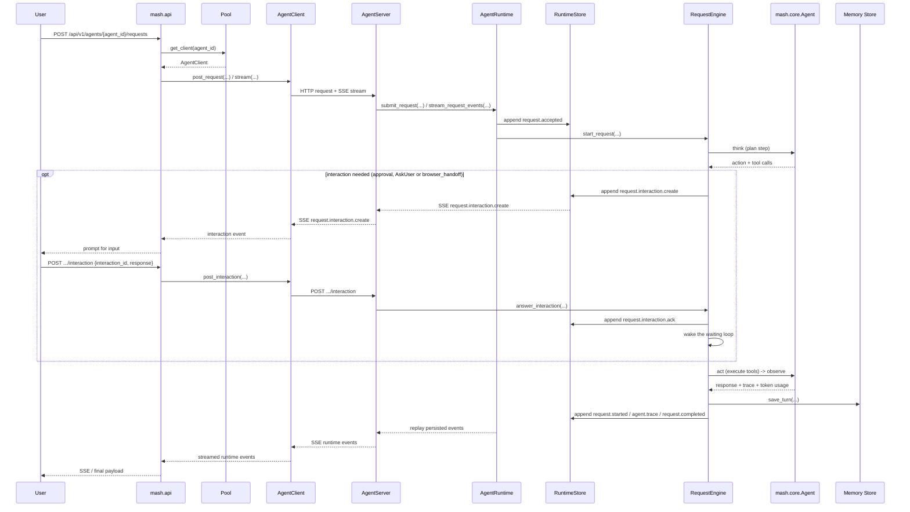

# Runtime

`src/mash/runtime` turns an [`AgentSpec`](./spec.py) into a hosted, request-driven agent runtime.

This package exists to do three jobs cleanly:

- run one agent instance as an addressable service
- preserve request progress as an append-only runtime event log
- delegate request execution to a durable workflow engine

The core design goal is to keep **event sourcing** and **runtime durability** separate.

- **Event sourcing** answers: "What happened during this request, in what order, and how do we replay it?"
- **Runtime durability** answers: "How does work continue safely across retries, restarts, and workflow boundaries?"

Those are related concerns, but they are not the same concern. The package is organized so developers can reason about each boundary independently.

## Public Surface

Import the public API from `mash.runtime`:

- `AgentSpec`: build contract for one agent
- `AgentRuntime`: per-agent execution core
- `AgentServer`: per-agent HTTP/SSE adapter; `token=` requires a bearer token on every route but `/health`
- `Pool`: deployed pool of role-less agents and workflows
- `Host`: immutable composition over the pool (primary + subagents + workflows)
- `HostBuilder`: pool construction API
- `AgentClient`: client for one addressable runtime
- `AgentMetadata`: agent self-description supplied at registration

Everything else under `src/mash/runtime` is internal implementation detail unless a test is explicitly targeting internals.

Workflow task `AgentSpec` objects passed through `HostBuilder.workflow(...)` are
registered as workflow-only runtimes. They can be targeted by `mash.workflows`
tasks but are hidden from public agent listings and subagent delegation.

Related READMEs:

- [`src/mash/workflows/README.md`](../workflows/README.md) — workflow layer,
  including step pipelines and per-step structured output.
- [`src/mash/skills/README.md`](../skills/README.md) — agent skills, including
  runtime registration.
- [`src/mash/core/llm/README.md`](../core/llm/README.md) — how provider
  adapters translate a structured-output schema into their native shape.

## Architecture

The runtime is intentionally split into four layers:

1. **Runtime core**
   - `service.py`
   - owns `AgentRuntime`
   - owns runtime state, lifecycle, request bookkeeping, and public runtime operations

2. **Event sourcing**
   - `events/types.py`
   - `events/protocol.py`
   - `events/store/` (Postgres backend; schema lives in the shared `mash/storage/migrations/` baseline)
   - defines the append-only runtime event model and the store interface used for replay/streaming

3. **Request durability**
   - `engine/engine.py`
   - `engine/loop.py`
   - `engine/steps.py`
   - runs each request as a loop that checkpoints to `runtime_request` after every step

4. **Supporting internal helpers**
   - `factory.py`
   - `context.py`
   - `requests.py`
   - `turns.py`
   - these are internal modules used by the runtime core and workflow code; they are not alternate public surfaces

## Request Flow

At a high level, a Mash request flows through the host API, into an agent
runtime, through the durable request engine, and back out as replayable runtime
events:



## Event Sourcing vs Durability

### Event Sourcing

Event sourcing in this package means every request is represented as an ordered stream of `RuntimeEvent` records.

The event log is used for:

- SSE replay
- request status reconstruction
- user-visible lifecycle streaming
- inspection/debugging of runtime progress

The event sourcing interface is:

- [`events/types.py`](./events/types.py)
  - `RuntimeEventType`
  - `RuntimeEvent`
- [`events/protocol.py`](./events/protocol.py)
  - `RuntimeStore` protocol
- [`events/store/`](./events/store/)
  - `PostgresRuntimeStore` implementation
  - `store/postgres/loaders.py` — all read/write query functions
  - schema migrations live in the shared [`mash/storage/migrations/`](../storage/migrations/) baseline

The `RuntimeStore` boundary is intentionally small:

- `append_event(...)`
- `list_events(...)`
- `list_request_events(...)`
- `has_request(...)`
- `is_request_terminal(...)`
- `get_request_lifecycle(...)`
- `read_request_stream(...)`
- `get_latest_trace(...)`
- `list_recent_traces(...)`
- `append_feedback(...)`
- `list_feedback(...)`

This is the replay/observation boundary. It should not know how a request is executed internally. It only records what happened.

A request's lifecycle state is one such record, not an inference: the events that move a request between states carry a `lifecycle` marker, and the store projects it onto a `runtime_request` row in the same transaction as the event. `read_request_stream(...)` is what the streaming path uses — it returns a request's new events and its terminality together, with terminality scoped to the events it just returned, so a caller that stops on `done` has necessarily been handed the terminal event. The row also records the request's `agent_id` and `user_id` from its accepted event; the host's `/h2a` relay reads them to check a subagent call's parent and copy its user. The accepted event also writes `session_id`, `mode` (`fg` or `bg`), `started_by` (`user`, or the agent whose `RunSubAgents` call started the request), `started_at` and `parent_request_id`, and `mash.request.mode_changed` updates `mode` in the same transaction as its append. `list_session_requests(...)` and `list_child_requests(...)` read them. The table is a projection of the log, written in the same transaction as each lifecycle event. The feedback pair is the one part written by a person rather than the engine: `/feedback` in the REPL appends a `runtime_feedback` row with the host, agent, session, and request id, and `GET /api/v1/feedback` reads it back for app developers.

### Runtime Durability

Durability in this package means an accepted request survives its process.
Each request runs as a loop whose state is checkpointed to its
`runtime_request` row after every step; a restarted process continues the
agent's running requests from their checkpoints. See
[`engine/README.md`](./engine/README.md).

- [`engine/engine.py`](./engine/engine.py)
  - `RequestEngine`: `open()` (recovers), `close()`, `start_request(...)`,
    `continue_request(...)`, `get_request_status(...)`, `cancel_request(...)`,
    `answer_interaction(...)`
- [`engine/loop.py`](./engine/loop.py)
  - `RequestRun`: one request's loop and checkpoint
- [`engine/steps.py`](./engine/steps.py)
  - the steps the loop runs

This is the execution and durability boundary. It does not replace the runtime event log.

## Runtime Responsibilities

[`service.py`](./service.py) is the center of the package.

`AgentRuntime` is responsible for:

- owning one agent definition and its configured dependencies
- exposing the public runtime operations used by server/host layers
- coordinating the memory store, runtime event store, and request engine
- configuring subagents and MCP-backed remote tools

`AgentRuntime` intentionally does **not** own:

- in-process request shadow state
- per-session locks or local concurrency controls
- runtime loop binding
- in-memory SSE wakeup queues

`AgentRuntime` is **not** where all implementation logic lives. The goal is:

- `service.py` owns the public runtime surface and mutable state
- helper modules implement focused internal logic
- workflow code can call focused helper modules directly when that is clearer than routing everything back through `AgentRuntime`

Direct runtime usage is explicit:

- hosted paths (`AgentServer`, `Pool`) call `open()` during startup
- direct callers should `await runtime.open()` before submitting or streaming requests

## Stores

The runtime keeps two different stores on purpose.

### `memory_store`

Provisioned by the caller and injected into `AgentRuntime` as a required
constructor parameter. The default factory is `AgentSpec.build_memory_store()`.

This store owns conversation-oriented state:

- saved turns
- signals
- summaries/compaction checkpoints
- logs and search-oriented memory data

This is the store used for conversation history and long-lived agent memory behavior.
It requires `MASH_DATABASE_URL` to be set. `build_memory_store()` raises
`RuntimeError` if the variable is absent; override the method to supply
a custom store implementation.

Signal definitions are runtime-owned metadata, not persisted rows. Hosted
runtimes expose those definitions from the same collector used during terminal
signal collection so session-signal readers see the exact built-in signal set
the runtime computes.

### `runtime_store`

Provisioned by the caller and injected into `AgentRuntime` as a required
constructor parameter. The standard implementation is `PostgresRuntimeStore`.

This store owns request-oriented state:

- accepted request records
- progress events
- started/completed/failed state
- replayable event streams for API clients

This is intentionally append-only and request-scoped.

### Store lifecycle and sharing

`AgentRuntime` does not create or close its stores; callers own that
lifecycle.

- **`AgentServer`** (in each agent process) creates its stores in
  `from_spec()` and closes them in its lifespan shutdown, after the runtime
  shuts down. Each agent process holds its own Postgres connections.

- **`Pool`** (on the host) opens one shared `PostgresRuntimeStore`, one shared
  `PostgresStore` and one `WorkflowStore` for the host's own reads: traces,
  telemetry, sessions, feedback, and workflow runs. It runs no agent runtimes.
  Session reads cover agents that use the default `build_memory_store()`; an
  agent that overrides it keeps its store in its own process only.

## File and Module Guide

### Root modules

- [`service.py`](./service.py)
  - `AgentRuntime`
  - runtime lifecycle, owned state, public runtime API
  - includes session history reads, session signal reads, and signal definition reads

- [`factory.py`](./factory.py)
  - builds/configures the in-process `Agent`
  - runtime tool wiring
  - MCP tool wiring
  - web search tool wiring (reuses the MCP manager, registers plain tool names)
  - `RunSubAgents` wiring on requests the user started; a child gets neither `RunSubAgents` nor `AskUser`

- [`context.py`](./context.py)
  - session history loading
  - compaction
  - token accounting
  - context serialization/deserialization
  - action/result payload conversion

- [`requests.py`](./requests.py)
  - request submission helpers
  - polling-based event streaming helpers
  - runtime-event append and public event shaping

- [`turns.py`](./turns.py)
  - one-turn execution helpers
  - think/tool-call execution
  - signal collection
  - turn persistence

- [`server.py`](./server.py)
  - per-agent HTTP/SSE surface

- [`client.py`](./client.py)
  - `AgentClient`: the H2A HTTP client for request submission, event streaming, interaction delivery, and control operations; `AgentUnavailableError` when the agent's server can't be reached

- [`agent_process.py`](./agent_process.py)
  - `build_agent_server(pool, agent_id, token=, host_api_url=, sandbox_tools=)`: the `AgentServer` behind `mash agent serve`; with `sandbox_tools` (the host sets `MASH_SANDBOX_ENABLED=1` when it has sandboxes) every turn agent gets `run_code` and `edit_file`, plus `sandbox_put` and `sandbox_get` when the spec's `sandbox_file_roots()` names folders (`mash.tools.sandbox`), and a spec with its own tool of one of those names fails to start. With `browser_tools` (the host sets `MASH_BROWSER_ENABLED=1` when it has browsers) an agent whose spec lists `browser_sites()` also gets the browser tools (`mash.tools.browser`), and the engine turns its `browser_handoff` calls into `browser` interactions carrying a live-view link. When the pool enables Cortex the runtime gets a `CortexReader` (`runtime.enable_cortex`): each request gets its user's profile block in `context.load` and `search_cortex`
  - `HostRelay`: the runtime's pool access in an agent process; subagent clients point at the host's `/h2a` relay
  - `stop_with_parent()`: an agent process shuts down when the host whose pid is in `MASH_PARENT_PID` exits

- [`sessions.py`](./sessions.py)
  - session reads over the memory store and event log, shared by the runtime and the host

- [`spec.py`](./spec.py)
  - `AgentSpec` contract

- [`errors.py`](./errors.py)
  - runtime-facing error classification helpers
  - `classify_error(...)`: pattern-matches errors into retryable/terminal categories
  - `is_retryable(...)`: boolean helper, defaults unknown errors to retryable
  - `retry_transient(...)`: async retry with exponential backoff for transient errors

### `engine/`

- [`engine/engine.py`](./engine/engine.py)
  - `RequestEngine`: starts, recovers, cancels and continues requests, stores interaction answers

- [`engine/loop.py`](./engine/loop.py)
  - `RequestRun`: the request loop and its checkpoint

- [`engine/steps.py`](./engine/steps.py)
  - the loop's steps
  - interaction event emission helpers (`emit_interaction_create`, `emit_interaction_ack`)

### `events/`

- [`events/types.py`](./events/types.py)
  - runtime event schema and the event set: each name is the span it bounds
    (`invoke_agent.start`/`.end`, `chat.start`/`.delta`/`.end`, `execute_tool.start`/`.end`,
    `mash.context_load.*`, `mash.step.end`, `mash.interaction.*`) or a log record name
    (`mash.request.resumed`, `mash.request.mode_changed`)
  - every `.end` carries `status` (`ok`, `error`, `cancelled`); OpenTelemetry attributes
    live under `payload["attributes"]` with their GenAI convention names

- [`events/store.py`](./events/store.py)
  - event store protocol and Postgres implementation

- [`../otel/projection.py`](../otel/projection.py)
  - the OpenTelemetry projection: `project_request(events, children=...)` pairs each
    start with its end and returns spans and log records with GenAI names and
    attributes; the admin UI reads it and the exporter sends it
  - open spans come back with `end_time` None, so running requests show
  - RunSubAgents children nest under the call that started them

- [`events/analysis.py`](./events/analysis.py)
  - deterministic trace analysis over the projection
  - `analyze_projection(projection)` computes timing breakdown, token aggregation, per-tool stats, per-step breakdown, and slowest operations
  - `TraceAnalysis` includes: timing (cold start, context load, chat, tool, subagent, idle), token counts, tool stats, step breakdown, and each child's own analysis
  - all computation is pure: no DB access, no LLM inference

### `host/`

- `host/host.py`
  - `Pool`
  - agent registrations, one `AgentClient` per enabled agent (from the configured `AgentProvider` at `start()`), the host (composition) registry, and the `SandboxManager` when the host has sandboxes. The pool runs no agent runtimes
  - `enable_agent` / `disable_agent`: start or stop one agent's process on a running pool. Disable raises `AgentInUseError` while a host or workflow names the agent; `get_client` raises `AgentDisabledError` for a disabled one. The enabled set is in memory

- `host/builder.py`
  - `HostBuilder`

- `host/types.py`
  - pool registration records, the `Host` composition type, and bootstrap session ids

- `host/subagents.py`
  - subagent metadata
  - prompt augmentation helpers

- `host/tokens.py`
  - per-agent tokens: HMAC of the agent id under `MASH_HOST_SECRET`, checked by deriving again

- `host/processes.py`
  - `AgentProcessProvider.ensure(agent_id)`: spawns `mash agent serve --host-app <app> --agent <id> --host 127.0.0.1 --port <free port>` with the host's environment, less `MASH_HOST_SECRET` and `MASH_API_KEY`, plus `MASH_AGENT_TOKEN`, `MASH_HOST_API_URL`, `MASH_SANDBOX_ENABLED` and `MASH_PARENT_PID`, then waits for `/health`
  - the child's output goes to the host's stderr, one line at a time, prefixed `[<agent_id>]`
  - a child that exits restarts on the same port, with backoff from 1 to 30 seconds; while it is down its routes return `503 AGENT_UNAVAILABLE`
  - `stop(agent_id)` and `close()` send SIGTERM, then SIGKILL after `stop_timeout`; `status(agent_id)` is `starting`, `running` or `unavailable`

## Request Lifecycle

At a high level, one request flows like this:

1. `AgentServer` receives a request and calls `AgentRuntime.submit_request(...)`.
2. `AgentRuntime` validates the required session id and appends `request.accepted`.
   A caller-supplied `request_id` that already exists for the agent returns the
   existing accepted payload instead (`AgentServer` answers `200`, not `202`).
   A `parent` object (`kind: "subagent"` or `"workflow"`) is mapped onto the
   request metadata keys the engine reads (`subagent_id`, `workflow_id`,
   `workflow_run_id`, `task_id`). The submit's `mode` (`fg` by default) and a
   `subagent` parent's `started_by` and `parent_request_id` go into the
   accepted event's payload.
3. `AgentRuntime` delegates execution start to the configured `RequestEngine`.
4. The request engine runs the loop in `engine/loop.py` over the steps in `engine/steps.py`, checkpointing after each.
5. Those steps load/build context, run think/tool phases, persist turns, and append `RuntimeEvent`s.
6. API clients stream those events from `runtime_store` through SSE replay in `server.py`; an append wakes the stream in memory.
7. Terminal state is represented by `request.completed` or `request.error`.

The key point is:

- **workflow durability executes the request**
- **event sourcing records the request**

Neither layer should absorb the other's responsibility.

## Structured Output

Requests can carry a JSON schema (or a Pydantic model) describing the shape
the agent's final response should match. After the agent produces its normal
free-text answer, the runtime makes a second LLM call —
[`finalize_structured_output`](./engine/steps.py) — that asks the model to
"produce the requested structured output for the preceding completed
assistant response. Preserve the answer's facts and do not add new
information." The returned JSON is attached to the response as
`structured_output` alongside the existing `text`, and persisted on the turn
by [`persist_completed_turn`](./engine/steps.py).

### Usage

Pydantic model:

```python
from pydantic import BaseModel

class ChangelogOutput(BaseModel):
    title: str
    commits_scanned: int

response = await runtime.submit_request(
    message="summarize recent commits",
    session_id="s1",
    structured_output=ChangelogOutput,
)
```

JSON schema dict:

```python
response = await runtime.submit_request(
    message="summarize recent commits",
    session_id="s1",
    structured_output={
        "title": "ChangelogOutput",
        "type": "object",
        "properties": {
            "title": {"type": "string"},
            "commits_scanned": {"type": "integer"},
        },
        "required": ["title", "commits_scanned"],
        "additionalProperties": False,
    },
)
```

Both paths go through
[`serialize_structured_output`](./structured_output.py); Pydantic models are
converted via `model_json_schema()`, dicts are passed through unchanged.
Anything else raises `TypeError`.

### Response shape

The structured payload appears alongside `text`:

```json
{
  "response": {
    "text": "I scanned the last five commits.",
    "structured_output": {"title": "Changelog", "commits_scanned": 5}
  }
}
```

### HTTP API

`POST /api/v1/agent/{agent_id}/request` accepts an optional
`structured_output` field on the body. The body must be a JSON-schema dict;
Pydantic models are serialized client-side by
[`src/mash/cli/client.py`](../cli/client.py) before being sent.

```bash
curl -X POST http://127.0.0.1:8000/api/v1/agent/primary/request \
  -H "Authorization: Bearer $MASH_API_KEY" \
  -H "Content-Type: application/json" \
  -d '{
    "message": "summarize recent commits",
    "session_id": "s1",
    "structured_output": {
      "title": "ChangelogOutput",
      "type": "object",
      "properties": {
        "title": {"type": "string"},
        "commits_scanned": {"type": "integer"}
      },
      "required": ["title", "commits_scanned"],
      "additionalProperties": false
    }
  }'
```

An invalid `structured_output` payload returns `400
INVALID_STRUCTURED_OUTPUT`.

### Per-task structured output

`WorkflowSpec` tasks can attach their own per-task schema. See
[`src/mash/workflows/README.md`](../workflows/README.md) (Per-Task Structured
Output) for the workflow-level usage and how task state derives from the
returned JSON.

## Interactions

Interactions allow an agent to pause mid-execution and request information or approval from the host before continuing. This supports human-in-the-loop workflows where tool execution requires explicit user consent, or the agent needs clarification.

### Interaction Types

| Type | Schema | Response shape |
|------|--------|----------------|
| `approval` | `{ "type": "enum", "options": ["approve", "deny", "skip"] }` | One of the enum values |
| `info` | `{ "type": "text" }` | Free-form string |
| `choice` | `{ "type": "multi_select", "options": [...] }` | Array of selected options |

### How Interactions Work

1. During the request loop, after `plan_request_step`, if the action payload contains an `interaction` field, the loop opens an interaction.
2. The loop emits a `mash.interaction.start` event (visible on SSE as `request.interaction.create`) and records the interaction's id and deadline in its checkpoint.
3. The loop waits in process until the deadline.
4. The host delivers the user's response via `post_interaction` on the client. The agent's server appends it as `mash.interaction.end` and wakes the loop.
5. The loop reads the answer and continues to tool execution.

### Durability

An interaction's answer is its `mash.interaction.end` event. If the process restarts while a request waits, the recovered loop finds the interaction in its checkpoint, reads the answer from the log if one arrived, and otherwise waits out the rest of the deadline. An answer to an interaction that is already closed returns `409 INTERACTION_CLOSED`.

### Timeout Defaults

If no response arrives within `timeout_seconds`:
- `approval` → defaults to `"deny"`
- `info` → defaults to `""`
- `choice` → defaults to `[]`

### Client Operation

`AgentClient.post_interaction(request_id, *, interaction_id, response)` POSTs to `/agent/{agent_id}/request/{request_id}/interaction`; the agent's server stores the response and wakes the request.

## Error Classification and Resumability

The runtime classifies errors as **retryable** (transient) or **terminal** (permanent) and retries transient failures automatically at the step level before emitting `REQUEST_FAILED`.

### Error Classification

[`errors.py`](./errors.py) provides `classify_error(error)` which pattern-matches error messages:

| Error pattern | `error_code` | `retryable` |
|---|---|---|
| Rate limits, 429 | `rate_limit_exceeded` | `True` |
| Timeouts | `timeout` | `True` |
| Connection/network errors | `network_error` | `True` |
| 502/503/504 server errors | `server_error` | `True` |
| Overloaded/capacity | `overloaded` | `True` |
| Context length exceeded | `context_length_exceeded` | `False` |
| Auth errors, 401 | `auth_error` | `False` |
| Permission denied, 403 | `permission_denied` | `False` |
| Invalid request, 400 | `invalid_request` | `False` |
| Unknown errors | `None` | `None` (defaults to retryable) |

### Step-Level Retry

Transient errors are retried automatically at the step level using `retry_transient()` from [`errors.py`](./errors.py). The two hot paths — LLM planning (`step.plan`) and tool execution (`tool.call`) — are wrapped in retry logic with exponential backoff and jitter.

- **Max retries**: configurable via `DEFAULT_MAX_STEP_RETRIES` (default: 3)
- **Backoff**: exponential with jitter, capped at `DEFAULT_RETRY_MAX_DELAY` (default: 30s)
- **Non-retryable errors**: not retried, propagate immediately
- **Exhausted retries**: the final exception propagates to the workflow error handler

### Failure Handling

There are three layers of failure handling, each covering a different scenario:

| Failure type | Handled by | Developer action |
|---|---|---|
| Transient error (rate limit, timeout, network) | `retry_transient()` — in-process, immediate, with backoff | None — automatic |
| Retries exhausted or terminal error | `REQUEST_FAILED` emitted | Call `resume_request()` to continue from the failed step, or rerun it |
| Cancelled | `REQUEST_CANCELLED` emitted | Call `resume_request()` to continue it |
| Step budget exhausted (`max_steps`) | `REQUEST_FAILED` with `error_code=max_steps_exhausted`, `stop_reason=max_steps` | Raise `max_steps` or narrow the task |
| Process crash (OOM, kill, hardware) | The restarted process continues it from its checkpoint | None; after 10 recoveries it fails with `error_type=recovery_limit` |

**Step-level retry** covers transient errors during normal operation. If retries exhaust or the error is non-retryable, the workflow emits `REQUEST_FAILED` with `error_code` and `retryable` fields from `classify_error()` so the developer knows what happened.

**Developer-initiated resume** covers requests that stopped without finishing: a cancelled one, or a failed one. `resume_request(request_id)` records the request running and continues it from its checkpoint, so the failed step runs again and the steps before it do not.

**Budget exhaustion is a failure, not a completion.** An agent that spends its whole `max_steps` budget without finishing raises `MaxStepsExhaustedError`, so the request fails before turn persistence, structured-output finalization, or `REQUEST_COMPLETED`. This keeps an unfinished turn from being finalized into a schema-valid but empty business result that a workflow would thread into its next step.

**Process crash recovery** covers the case where an agent process dies mid-step (killed, OOM, hardware failure). No exception handler runs, so no `REQUEST_FAILED` is emitted, and the request stays `running` in `runtime_request`. The host restarts the process, and on startup its engine reads the agent's `running` requests and continues each from its checkpoint; the step that was running runs again. Only the agent's own process continues its requests, since recovery selects by `agent_id`. A host restart restarts every agent the same way, and a disabled agent's running requests continue when it is enabled. This is one query at startup; an idle process makes no others.

### Request Status, Cancel, Resume, and Rerun APIs

`AgentRuntime` exposes five methods for inspecting and controlling a request:

- `get_request_status(request_id)` reads the request's status from `runtime_request`: `running`, `completed`, `failed` or `cancelled`. A `running` request whose stream has gone quiet after a crash continues when its agent's process restarts.

- `cancel_request(request_id)` acks a pending interaction as cancelled, emits `REQUEST_CANCELLED`, and stops the loop at the next step boundary; the step in flight finishes and checkpoints. Idempotent on a request that is already terminal.

- `resume_request(request_id)` continues a `cancelled` or `failed` request from its checkpoint: it emits `REQUEST_RESUMED`, which records the request running, then restarts the loop. Rejects with `RequestStaleError` when the session has accrued a newer replayable turn, since resume continues from the request's original context. Returns informational status if the request is already running or completed.

- `set_request_mode(request_id, mode)` switches a running request between `fg` and `bg` by appending `mash.request.mode_changed`. It raises `RequestTerminalError` once the request is terminal. The mode tells clients whether the conversation waits on the request; it does not change how the request runs.

- `rerun_request(request_id)` — submits a new request built from the original's `request.accepted` payload (message plus full request metadata, including the host snapshot), with `rerun_of` stamped into the metadata. New request id, new trace, and `context.load` runs fresh against the session's current history. Works regardless of the original's terminal state.

These are also available through `AgentClient` and the HTTP API:

- `GET /agent/{agent_id}/request/{request_id}/status`
- `POST /agent/{agent_id}/request/{request_id}/cancel`
- `POST /agent/{agent_id}/request/{request_id}/resume`
- `POST /agent/{agent_id}/request/{request_id}/rerun`
- `POST /agent/{agent_id}/request/{request_id}/mode` (`409 REQUEST_TERMINAL` once terminal)

On the host, both cancel routes (by request and by trace) also cancel the request's running `RunSubAgents` children, each through its own agent. The request, parked in its `RunSubAgents` step, stops at the step boundary once they end. `GET /agent/{agent_id}/sessions/{session_id}/requests` lists a session's requests newest first, filtered by `mode`, `status` and `started_by`.

Trace and request are one to one, so the admin UI addresses a request by the trace it is already showing; the same four operations are exposed keyed by trace id, with the request id resolved server-side:

- `GET /agent/{agent_id}/trace/{trace_id}/status`
- `POST /agent/{agent_id}/trace/{trace_id}/cancel`
- `POST /agent/{agent_id}/trace/{trace_id}/resume`
- `POST /agent/{agent_id}/trace/{trace_id}/rerun`

## Important Interfaces

### Runtime event interface

Use this when you need to change request replay/streaming behavior:

- `RuntimeEventType`
- `RuntimeEvent`
- `RuntimeStore`
- `PostgresRuntimeStore`

Questions that belong here:

- Do we need a new request lifecycle event?
- How should replay ordering or dedupe work?
- What should SSE clients be able to reconstruct from stored events?

### Request engine interface

Use this when you need to change how durable work is started or resumed:

- `RequestEngine`
- `RequestRun`

Questions that belong here:

- How is a request started durably?
- What does the checkpoint hold, and when is it saved?
- How are recovery, cancel and resume handled?

## Design Rules

These rules should keep the package understandable over time.

- `AgentRuntime` is the per-agent execution core.
- `AgentServer` is the per-agent transport wrapper.
- `Pool` is agent lifecycle; `Host` values are composition. Roles are
  per-request (from the host snapshot), never runtime state.
- `RuntimeStore` is the append-only runtime event log boundary.
- `RequestEngine` is the workflow durability boundary.
- `memory_store` and `runtime_store` stay separate.
- Helper modules stay focused; they should not become a second public API.
- Event sourcing changes should usually land under `events/` or `requests.py`.
- Workflow durability changes should usually land under `engine/`.

## When Editing This Package

If you are making a change, ask first which boundary you are changing:

- **Agent behavior/configuration?**
  - start with `spec.py`, `factory.py`, or `context.py`

- **Request replay or streaming semantics?**
  - start with `events/` and `requests.py`

- **Durable execution semantics?**
  - start with `engine/`

- **HTTP/SSE contract?**
  - start with `server.py` or `client.py`

- **Multi-agent composition?**
  - start with `host/`

That separation is the point of this package layout.

## Mushy / Admin Thoughts

The runtime always enables textual thought summaries on its planning providers,
including request-scoped ones. Only Gemini currently implements enablement;
unsupported providers use a no-op default. No agent configuration is required.
The summaries remain in `chat.end`; answers and tool behavior
are unchanged. No interpreter lifecycle is involved.

`RuntimeStore.list_thought_traces(app_id=None, limit=50, trace_id=None)` reads the latest
thought-bearing traces and all their nonempty summaries from one SQL snapshot.
Agent/trace filtering and nonempty-string qualification precede the trace limit.
Admin displays these words in full. The pool uses its existing shared event
store; there is no separate Mushy service/store. Migration 003 adds only the query index;
Thoughts needs no new tables. See [Mushy](../mushy/README.md).
